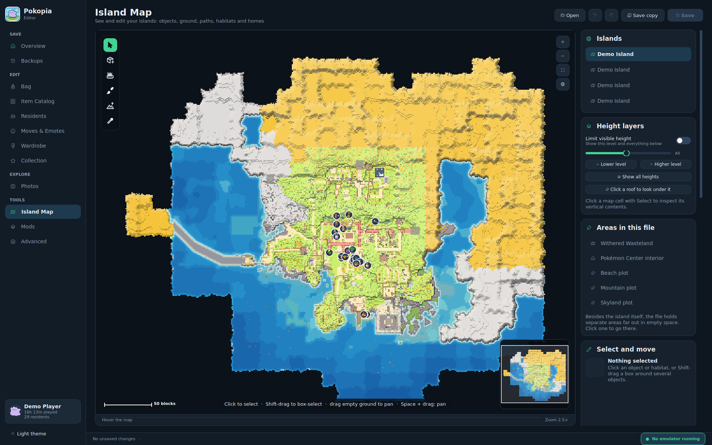
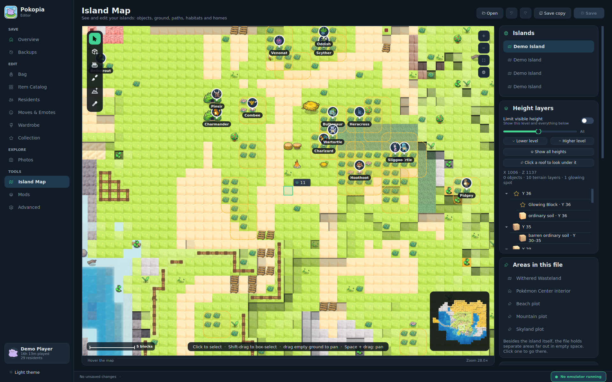
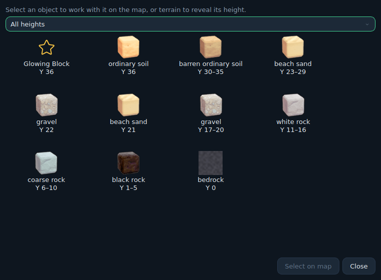
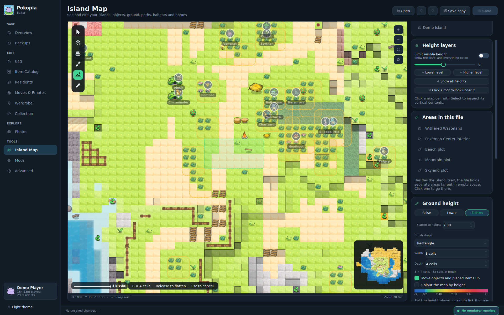
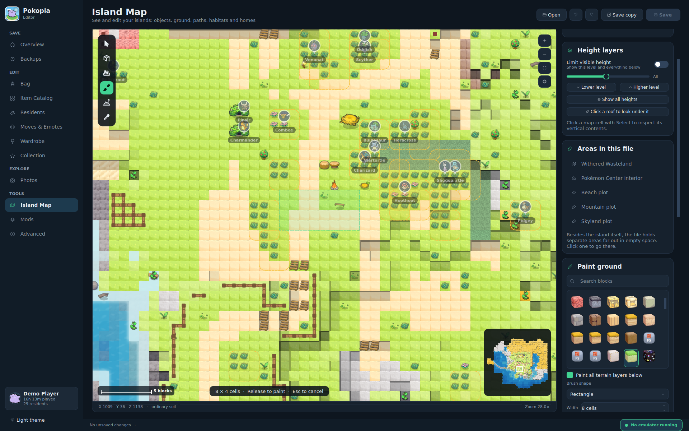
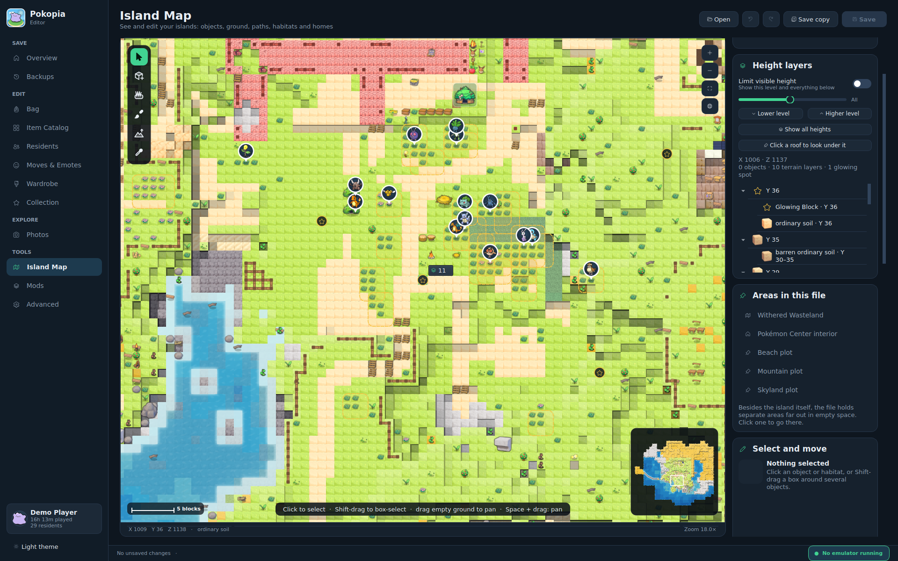
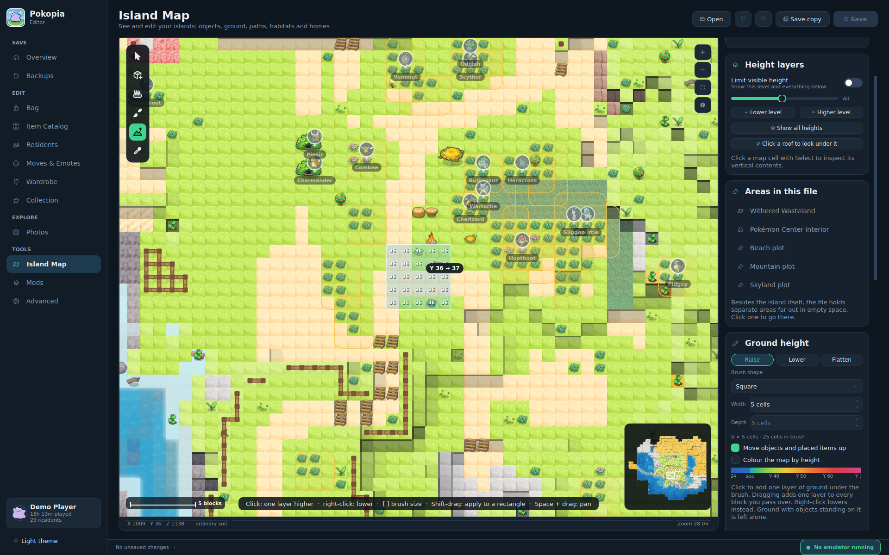
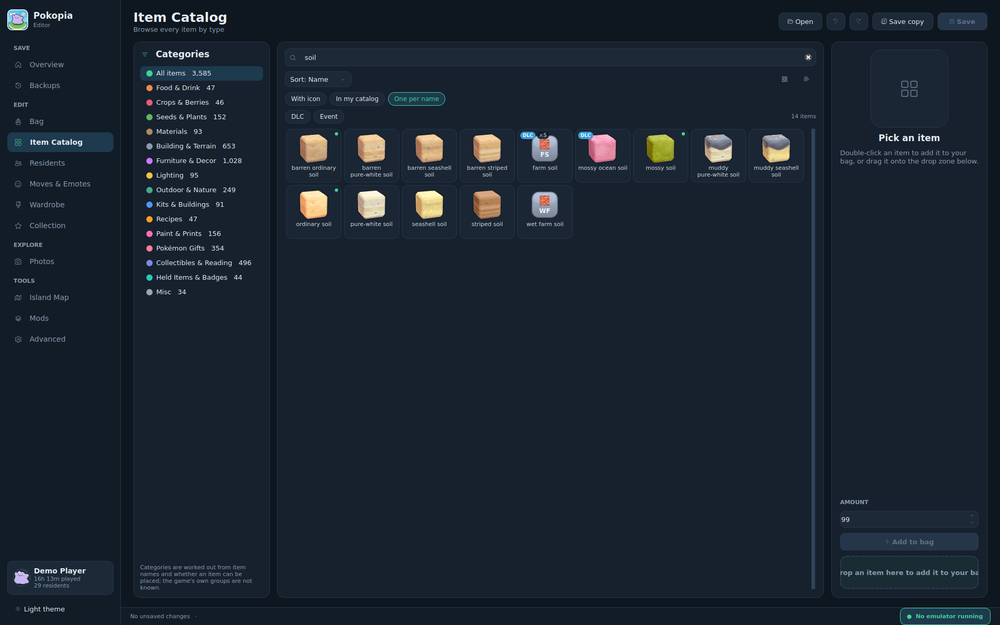

<div align="center">


# Pokopia Editor for Linux

**An independently maintained Linux fork with AppImage releases and additional map-editing tools.**


</div>

Maintained by **[frinimini](https://github.com/frinimini/Pokopia-Editor-Linux)**.
Built on **[Pokopia Editor by cycalo and contributors](https://github.com/cycalo/Pokopia-Editor)**,
upstream version **1.9.2**. The original editor remains credited separately from
this fork's Linux integration and additional features. See [credits and licenses](CREDITS.md).

[Download Linux 1.1.0](https://github.com/frinimini/Pokopia-Editor-Linux/releases/tag/linux-v1.1.0) ·
[Linux additions](#linux-port-and-additional-features) ·
[Screenshots](#screenshots-of-the-linux-edition) ·
[Upstream features](#upstream-editor-features) ·
[Contributing](CONTRIBUTING.md)

## Download and run on Linux

Download **PokopiaEditor-1.1.0-x86_64.AppImage** from
[our Linux release](https://github.com/frinimini/Pokopia-Editor-Linux/releases/tag/linux-v1.1.0), then:

```sh
chmod +x PokopiaEditor-1.1.0-x86_64.AppImage
./PokopiaEditor-1.1.0-x86_64.AppImage
```

Built and tested on **Ubuntu 26.10 x86_64**, requiring **glibc 2.44**.
Older distributions are unverified. If FUSE is unavailable, use:

```sh
./PokopiaEditor-1.1.0-x86_64.AppImage --appimage-extract-and-run
```

Close the emulator before editing its on-disk save. Choose **Open → Browse for a
folder** to open an emulator or Recompia save; it contains `G00/CMNDAT.BIN`.
Keep a backup and use **Save copy** when trying edits. **F5** reloads an in-game save.
The release includes source, dependency notices, a manifest and checksums.
See [1.1.0 release notes](docs/releases/1.1.0.md).

## Linux port and additional features

These additions are maintained in this fork by frinimini. The underlying save
editor, original map tools, Item Catalog and game mods come from upstream.

| Addition in this fork | What it provides |
|---|---|
| Linux desktop integration | AppImage packaging, XDG settings, system folder opening, emulator detection and bundled toolbar icons |
| Experimental Linux live editing | Launch Lichii through the editor and change forms while playing the verified game build |
| Height-layer inspector | Inspect terrain bands and objects grouped by Y height, then reveal a level |
| Tile contents and catalog icons | Open a tile's contents in an icon grid using the existing catalog assets and block-to-item mapping |
| Brush shapes and dimensions | Circle, Square and Rectangle brushes, independent width/depth and cell counts |
| Rectangle height and paint actions | Shift-drag an area, then release to apply the chosen action |
| Objects lifted with terrain | Optionally move obstructing placed items and their stacks upward when raising ground |
| Painting underlying terrain | Optionally paint existing terrain beneath the visible surface in one action |
| Glowing Block markers | Display saved treasure positions, including buried spots; unopened rewards remain unknown |
| Remembered tool settings | Restore tool choices, filters, brush settings, height options and map view |
| Spacebar focus fix | Space-drag pans even after changing a sidebar control |

## Screenshots of the Linux edition

Screenshots use demo labels and hide local save paths. Click an image to open it at full size.

| | |
|---|---|
| **[Island Map overview](#inspect-stacked-height-layers)**<br>[](docs/screenshots/linux/01-island-map.png)<br>Explore terrain, objects, habitats and homes. | **[Height layers](#inspect-stacked-height-layers)**<br>[](docs/screenshots/linux/02-height-layers.png)<br>Inspect objects and terrain grouped by Y height. |
| **[Tile contents](#tile-contents-and-catalog-icons)**<br>[](docs/screenshots/linux/03-tile-contents.png)<br>Open a tile stack and choose an entry by its icon and height. | **[Height rectangles and object lifting](#raising-ground-beneath-objects)**<br>[](docs/screenshots/linux/04-height-rectangle-lift.png)<br>Shift-drag an area; optionally lift obstructing placed objects. |
| **[Paint rectangles and underlying layers](#painting-rectangles-and-terrain-layers)**<br>[](docs/screenshots/linux/05-paint-rectangle-layers.png)<br>Shift-drag to paint an area; optionally include terrain below. | **[Glowing Blocks](#glowing-blocks)**<br>[](docs/screenshots/linux/06-glowing-blocks.png)<br>Find saved treasure positions, including buried spots. |
| **[Square and rectangle brushes](#map-brush-shapes)**<br>[](docs/screenshots/linux/07-square-brush.png)<br>Choose a footprint and dimensions with an exact cell count. | **[Item Catalog icons](#upstream-editor-features)**<br>[](docs/screenshots/linux/08-item-catalog.png)<br>Browse item icons, including the terrain used in the map inspector. |

## Using the Linux additions

The following controls extend the inherited Island Map editor. Each heading links
to a specific feature; ordinary save editing and mod instructions are in the
[upstream editor guide](docs/upstream-guide.md).

### Map brush shapes

Paint ground and Ground height support Circle, Square and Rectangle brushes.
Choose the shape in the tool panel and set the width in cells. Rectangle also
allows an independent depth. Each dimension supports 1–32 cells. The panel shows
the footprint count, for example 8 × 4 = 32 cells. Height labels and the map outline
follow that footprint. Terrain rules can skip cells that cannot be edited.
Paint and height tools keep separate brush settings. The bracket keys adjust width.

### Inspect stacked height layers

The Height layers panel sits below the island selector. With Select active, click a
map cell to list its placed objects and contiguous terrain bands, grouped by their
top Y height. Entries show their full vertical range and whether they are hidden or
partly visible at the current cutoff. The inspected cell is outlined on the map.

Click an entry to reveal its height and select its object. Lower level and Higher
level move between occupied heights at that cell. Show all heights restores the
complete view. The slider and roof-picking shortcut remain available for cutaway
viewing. Visibility switches are grouped separately under Map overlays.

These controls change the view and selection. Viewing different heights does not
change save data. The groups describe occupied Y heights.

### Tile contents and catalog icons

Terrain entries in Height layers use the Item Catalog icon through the existing
block-to-item ID mapping. Terrain without a catalog item uses a texture thumbnail. Click the
stack badge beside an inspected tile to open its contents as an icon grid. Filter
by Y height and select an object to return to the map with that object selected.
Terrain entries reveal their height and clear the previous object selection.

### Raising ground beneath objects

Ground height has a **Move objects and placed items up** option. When enabled,
Raise and the raising part of Flatten lift obstructing objects and their stacks
onto the new surface, preserving their horizontal positions. The choice is remembered.
Terrain and object movement undo together. A blocked destination cancels the stroke.
Lowering leaves objects in place. Loose dropped collectibles and Glowing Blocks
are not moved by this option.

### Rectangular height edits

With Ground height selected, **Shift + drag** marks a rectangle. Release to apply
the selected Raise, Lower or Flatten mode to every cell in it. Esc cancels before
release. The object-lifting option applies, and the rectangle is one undo step.

### Painting rectangles and terrain layers

In **Paint ground**, **Shift + drag** paints a rectangle on release (Esc cancels).
Enable **Paint all terrain layers below** to paint the surface and existing terrain
beneath it with the chosen block. Bedrock, liquids, empty spaces, objects and
buried building blocks are preserved. The checkbox is remembered; brush strokes
and rectangles each undo as one action. Height limits restrict painting to the
visible surface and terrain below it.

### Panning with the spacebar

Hold **Space + drag** over the map to pan with any tool, including Ground height,
even after using sidebar controls. Release Space to resume editing.

### Remembered tool preferences

The editor restores the last page, tool choices, map brushes, height options,
visibility switches, map zoom and position for the last save, search filters,
item-browser category/layout, mod selections and photo position. Preferences are
saved when changing pages and closing the editor. Existing settings are supported.

### Glowing Blocks

Map overlays includes a Glowing Blocks switch. Gold stars mark saved treasure
positions, including buried spots. Clicking a marker inspects that tile; its Height
layers group and contents dialog include a read-only Glowing Block entry at its Y
height. Selecting the entry reveals its height without selecting an editable object.

The position table was checked against an in-game spot at X 1006, Y 36, Z 1137 using
three backed-up states. Breaking the block cleared that position. Collecting the
resulting disc left the position cleared. Other markers still need in-game testing.
Reward types and the table's additional fields remain undecoded. Marker display
uses the saved state, so reload after an in-game save to refresh it.

## Linux live memory editing

On the Mods page, use **Launch emulator** to select the Lichii AppImage, then open
Pokopia and load into the world. Keep the editor open during the session.
Launching the emulator through the editor allows
memory access under the usual Linux parent-process ptrace policy. If the emulator
was started independently and access is denied, close it and relaunch through the editor.
Other system restrictions can still prevent attachment.

Install Play as Pokemon, enable it in the emulator's game Properties → Add-Ons, and
restart the game before using Transform. The editor verifies the supported game
code hash and the installed patch before changing forms. The supported build is
Pokopia 2.0.0, update 655360. Other emulator memory layouts may need further work.

Manual gameplay verification on November 24, 2026 confirmed live transformation
to Pikachu in Lichii on Ubuntu 26.10 using the AppImage. The emulator was launched
through the editor. This does not establish compatibility with every form, emulator or game state.

Linux backend tests use a controlled child process to check attachment, memory
reads/writes, transformation fields, return-to-character fields and rejection of a
mismatched build. Save editing tests use a backed-up copy of a real save. Keep a
backup before testing mods in the game.

## Linux settings and source build

Settings use `$XDG_CONFIG_HOME/pokopia-editor/settings.json`, defaulting to
`~/.config/pokopia-editor/settings.json`. Backups use `~/Documents/Pokopia_Save_Backups`.

To run this fork from source, install Python 3 with venv support:

```sh
git clone https://github.com/frinimini/Pokopia-Editor-Linux.git
cd Pokopia-Editor-Linux
python3 -m venv .build-venv
.build-venv/bin/python -m pip install -r packaging/requirements-linux.txt
.build-venv/bin/python pokopia_gui.py
```

### Linux build

To build on x86_64 Linux, install Python 3 with venv support and
[appimagetool](https://github.com/AppImage/appimagetool/releases), then run:

```sh
python3 -m venv .build-venv
.build-venv/bin/python -m pip install -r packaging/requirements-linux.txt
bash tools/build_appimage.sh
```

Set `APPIMAGETOOL` to its executable path if it is outside PATH.
The AppImage is written to `dist/`. The unpacked app is also available at
`dist/PokopiaEditor/PokopiaEditor`. Build on the oldest Linux distribution you
intend to support, since AppImage packaging retains the build host's glibc requirements.

The Linux UI bundles Microsoft Fluent System Icons under the MIT license.
Font source: https://github.com/microsoft/fluentui-system-icons/tree/main/fonts
License: `data/fonts/LICENSE-FluentSystemIcons.txt`.

## Known issues

- **Cut and Rock Smash while transformed** — reported during Linux gameplay testing
  on November 24, 2026. After transforming into Pikachu or other Pokémon, selecting
  these moves from the move wheel did not perform the expected action. Live
  transformation itself worked. The cause has yet to be confirmed. Use **Turn back**
  to return to the normal character before attempting these moves. This workaround
  still needs in-game verification.
- The bundled upstream mod implements Grow, Burn, Water and Generate as Pokémon
  specialty actions. Its documentation lists Chop, Crush, Recycle and other
  specialties as unimplemented. The reported move-wheel issue above requires
  separate investigation.

- Glowing Block rewards and additional position-table fields are undecoded.
- Object lifting excludes loose drops and Glowing Blocks; lowering leaves objects in place.
- Painting all layers replaces terrain resources such as ore. It preserves bedrock,
  water, air, objects and buried building blocks. Try it on a save copy first.

## Upstream editor features

The following capabilities were created by **cycalo and upstream contributors**
and are inherited by this fork. The Linux additions above build on that work.

| Upstream page | Inherited capabilities |
|---|---|
| Overview | Player information, rename tools and one-click unlock actions |
| Bag and Item Catalog | Inventory editing, item search, icons, categories and quantities |
| Residents | Friendship, meeting information and resident homes |
| Moves and Emotes | Learned actions and move/emote wheels |
| Wardrobe | Outfits, hairstyles and expansion content |
| Collection | Pokédex, Habitat Dex, recipes, records, artifacts and other collections |
| Island Map | Place, move and delete objects; edit terrain and paths; create habitats; export maps |
| Photos | Browse the in-game album and export images |
| Backups | Create, compare, restore and delete backups |
| Mods | Play as Pokemon and Unlimited Crafting Storage Range |

For the original page descriptions, mod installation, controller combinations,
shared shortcuts and Windows source-build instructions, read the
[upstream editor and mod guide](docs/upstream-guide.md).
Original Windows downloads remain at [cycalo's releases](https://github.com/cycalo/Pokopia-Editor/releases/latest).

## Credits, licensing and contributions

- **Original editor and mods:** cycalo and upstream contributors.
- **Linux integration and fork additions:** frinimini, developed with assistance
  from OpenAI Codex.
- **Save data and research credited upstream:** [PokoHex](https://github.com/berichan/PokoHex).
- **Third-party components:** their existing notices and ownership are preserved;
  see [CREDITS.md](CREDITS.md) and [dependency source information](packaging/SOURCES.md).

This fork remains under **[GNU GPLv3](LICENSE)**. Its Linux branding does not
transfer ownership of upstream code or third-party material. Pokémon names,
icons and game assets belong to their respective rights holders, including
Nintendo, Game Freak and The Pokémon Company. This is a fan-made tool, unaffiliated
with them.

For this fork's issues and contributions, use
[frinimini/Pokopia-Editor-Linux](https://github.com/frinimini/Pokopia-Editor-Linux)
and follow [CONTRIBUTING.md](CONTRIBUTING.md). Upstream project discussion belongs
at [cycalo/Pokopia-Editor](https://github.com/cycalo/Pokopia-Editor).
